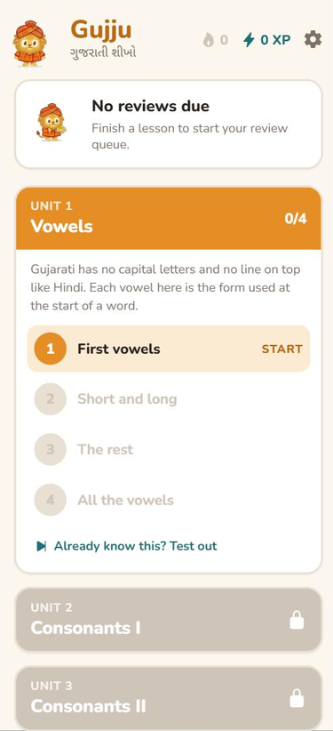
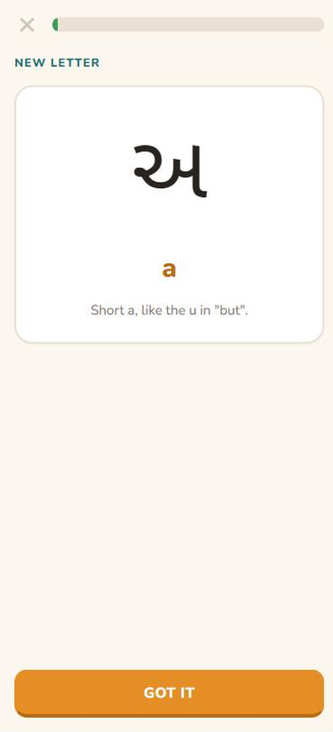
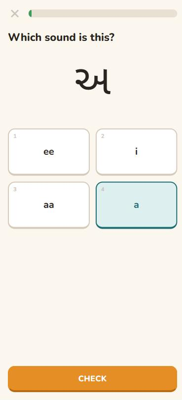
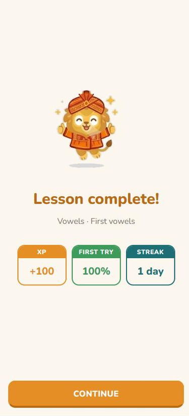
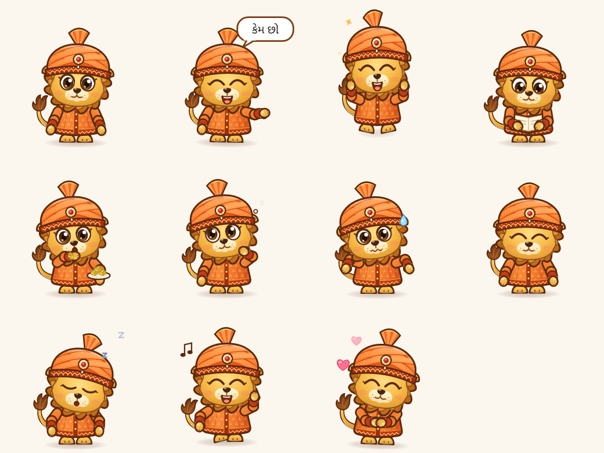

# Gujju


A free, Duolingo-style app for learning to read and write Gujarati. It starts with the script, because that's where most people get stuck (plenty of us grew up hearing Gujarati at home and still can't read a menu), then moves on to words and short sentences.

I'm a native speaker, and the course is built around that: which letters come first, which ones learners mix up, and how words are actually said at home rather than how a word list spells them.

Runs on iOS and the web from one Expo codebase, works offline, and keeps your progress on the device.

<p>
  
  
  
  
</p>

## What's in it

- **10 units, 43 lessons**: vowels, two consonant units, vowel signs, joined letters, numbers, then greetings, family, simple sentences and daily life
- **Five exercise types**: pick the sound, pick the letter, match pairs, build the word from letter tiles, build the sentence from a word bank
- **Short lessons**: 10 to 12 exercises, about five minutes. Anything you miss comes back at the end of the lesson until you get it
- **No hearts**: a wrong answer costs you the retry and nothing else
- **Spaced repetition** with FSRS. Every letter, word and sentence has its own schedule, and the home screen shows how many are due today
- **XP and a daily streak**, plus a test-out quiz to skip a unit you already know
- **Transliteration fades out** across units 7 to 10 (shown, then tap-to-reveal, then gone) so you end up actually reading the script
- **Kesar** (કેસર), the mascot: a Gir lion in a saffron pagdi, named after saffron and the Gir Kesar mango

## Running it

```bash
npm install
npm run web       # browser
npm start         # then scan the QR code with Expo Go on your phone
npm test
npm run typecheck
```

On the web, number keys pick an answer, Enter checks and continues, and Backspace removes the last tile.

## How it's built

```
content/            one JSON file per unit: lessons + items
src/app/            screens (Expo Router)
src/lib/            exercises, lesson session, scoring, FSRS, streak; no React
src/storage/        one Store interface, SQLite on iOS, IndexedDB on web
src/session/        the lesson player and the five exercise views
src/mascot/         Kesar's rig (parts, joints, clips) and the component that animates it
src/state/          progress context, the only thing screens talk to
scripts/            renders Kesar outside the app: pose sheet, README gif, app icons
```

**Content is data, progress is a database.** Units, lessons and items live in JSON in the repo, so the course is version controlled and doesn't need a backend. Only progress is stored: `lesson_progress`, `card_state`, `review_log` and `daily_stats`, with column names that map straight onto Supabase tables for when sync is added.

**Exercises are generated, not hand-written.** A lesson just lists its items. The generator builds the exercises from them and picks wrong answers from what you've already seen, starting with each item's `confusables` (ઇ/ઈ, ઘ/ધ, saat/saaTh). Hand-writing ~450 exercises with three distractors each would have been most of the work, and the mistakes would be the hard kind to spot. The confusables list is where a native speaker's judgement goes instead.

**Why FSRS.** It's the scheduler Anki moved to, it's open source, and the [ts-fsrs](https://github.com/open-spaced-repetition/ts-fsrs) package is well tested, so there was no reason to write my own SM-2 variant. Ratings come from the answer: right first time is Good, right after one miss is Hard, missed twice or more is Again. Every answer goes into `review_log` so the parameters can be fitted to real data later. Short-term learning steps are turned off because this is a once-a-day app, so the shortest interval is a day. New items are capped at 20 a day so reviews never pile up.

**Why local-first.** Lessons are played on a phone, often with bad signal. Everything is written to the device in one transaction when a session ends, and the UI never waits on the network. The streak is calculated from `daily_stats` every time instead of being stored, so it can't drift out of sync.

**Why IndexedDB on the web instead of SQLite.** `expo-sqlite` on the web is still alpha in SDK 57 and needs cross-origin isolation headers. For a few hundred rows that isn't worth it, so the web build uses IndexedDB behind the same interface.

**Fonts.** Noto Sans Gujarati is bundled. System Gujarati fonts differ a lot in how they draw joined letters, and a reading app can't have that.

## Editing the course

Each unit is one file in `content/`. An item looks like this:

```json
{ "id": "l-gha", "type": "letter", "gujarati": "ઘ", "translit": "gha", "english": "",
  "notes": "g with a breath after it. Watch out: ઘ and ધ (dha) look alike.",
  "confusables": ["l-ga", "l-dha"] }
```

`npm test` checks the content too: unique ids, lessons only pointing at real items, Gujarati fields actually in Gujarati script, no two items sharing an answer, and every lesson producing 10 to 12 exercises.

Transliteration: a capital letter means a retroflex sound (Ta, Da, Na, La), and an `n` after a vowel means the vowel is nasal (hun, chhun, kyaan).

## Status

- [x] Content format and lesson player
- [x] All five exercise types, retries, XP, streak
- [x] Script units 1 to 6
- [x] Review queue with FSRS
- [x] Word and sentence units 7 to 10 (first draft, about 120 words)
- [ ] Full read-through of every item, and more vocabulary toward ~300 words
- [ ] Sign-in and sync between devices (Supabase)
- [ ] iOS build on a real phone, web deploy on Vercel
- [ ] Audio: one recording per item as `<item id>.m4a`. The `audioFile` field is already there

## Mascot

Kesar is a layered SVG rig in the same spirit as a puppet: about 30 parts, each turning on its own joint (shoulder, elbow, neck, ears, tail and the tuft at its tip, the fan on his pagdi). Poses are data in `src/mascot/rig.ts`, keyframes with their own timing, so a clip can have a crouch before a jump, a squash on landing, and a tail that catches up a beat late. Arms are posed by saying where the paw should go; a two-bone solver works out the shoulder and elbow.

On top of every clip he breathes, blinks at random, and his eyes follow your pointer on the web, with the face sliding a little toward where he's looking so the head seems to turn. Reduced-motion settings are respected.



`npm run kesar -- poses|gif|icons` renders him outside the app from the same rig, which is how the gif above and the app icon are made. His original sprite sheet is kept in `assets/mascot/source.jpg` as the design reference.
